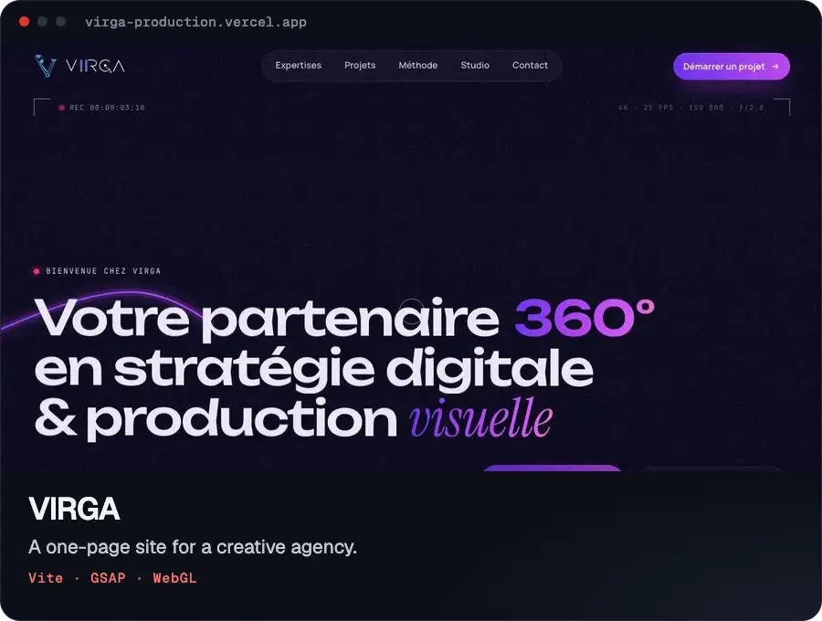

# VIRGA — website

One-page site for VIRGA (360° digital & creative agency). Vite + vanilla JS, GSAP (ScrollTrigger, SplitText, MorphSVG, DrawSVG, ScrambleText), Lenis smooth scroll, and a custom WebGL shader for the hero. Site copy is in French, taken from the brief.

Live: https://virga-production.vercel.app



## Run

```bash
npm install
npm run dev      # http://127.0.0.1:5173
npm run build    # static site in dist/
npm run preview  # serve dist/ locally
```

`dist/` deploys as-is to any static host (Netlify, Vercel, Cloudflare Pages, OVH…).

## Editing content

All repeated content lives in **`src/data.js`**: projects, services, method steps, partners, contact details. `src/render.js` turns it into static HTML at build time, so the content is in the page source for SEO and works without JavaScript.

### Films

"Regarder le film" buttons open an in-site player. It currently points to the Google Drive files in the *VIRGA PORT* folder (`drive: '…'` in `projects`), so **those files must be shared as "Anyone with the link"**, or visitors will see an access error. For smoother playback, upload the films to YouTube or Vimeo and replace `drive` with `youtube: 'ID'` or `vimeo: 'ID'`.

### Images

`public/media/*.webp` are stills captured from the portfolio films (large + 720px `-sm` version). To add one, drop `name.webp` and `name-sm.webp` in there and declare its size in `media` (`src/data.js`).

## Structure

```
index.html            page markup + brief copy
src/data.js           content
src/render.js         build-time HTML (services, projects, inline logo SVGs…)
src/assets/           VIRGA logo redrawn as SVG (mark + wordmark)
src/styles/main.css   design tokens + all sections
src/js/
  core.js             GSAP, Lenis, helpers
  preloader.js        intro: logo draws in, the "‖" bars morph into "▶", iris opens
  hero-gl.js          hero shader: violet duotone + lens that reveals true colour
  hero.js             hero: headline, curve + node, timecode, scene labels
  sections.js         marquee, FPV fly-through, reveals, 3D film strip, edit timeline
  lab.js              Web / AI / Automation demos
  contact.js          3-step brief form
  modals.js           project sheets + video player
  cursor.js, ui.js    cursor, header, menu, HUD, clock
```

## Accessibility & performance

- `prefers-reduced-motion`: no intro, no smooth scroll or pinned sections, content shown directly.
- Mobile: pinned sections become a swipe carousel and a list of steps; the shader renders at lower resolution and pauses off-screen or in background tabs.
- Dev only: `?forcetick` keeps animations running in hidden tabs (handy for screenshots).
